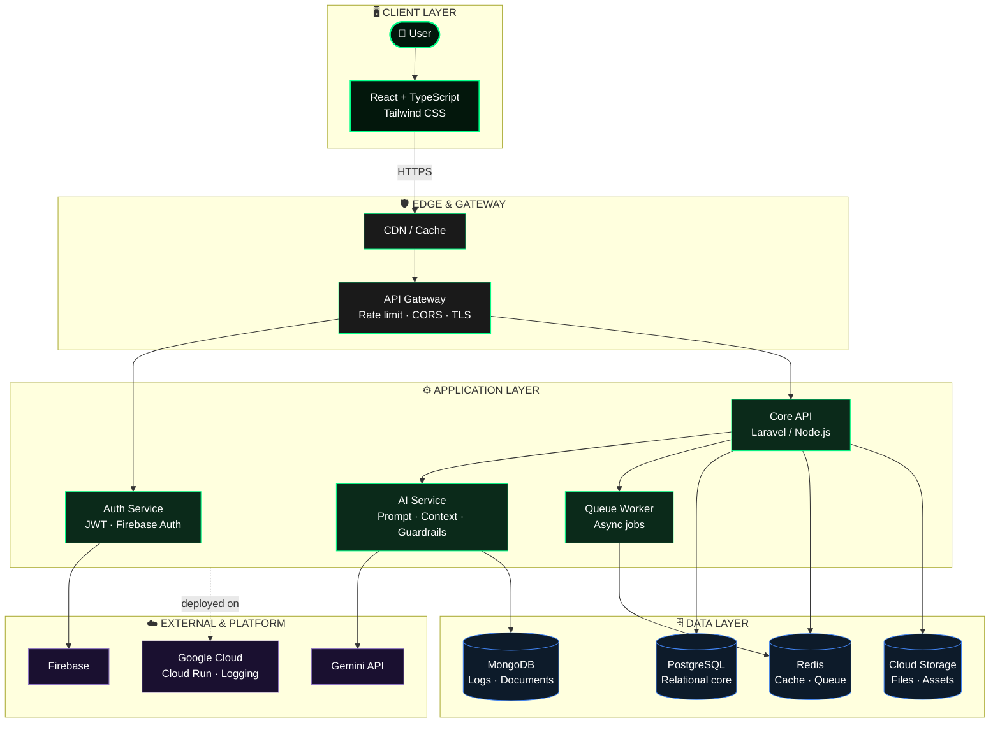
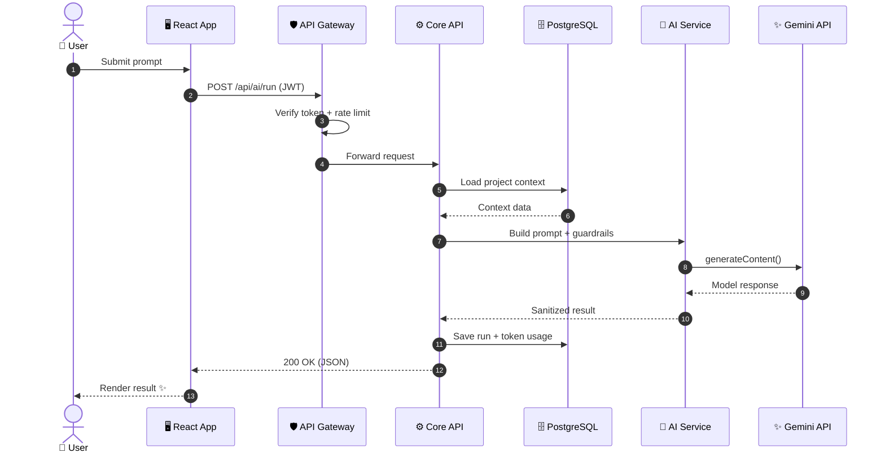
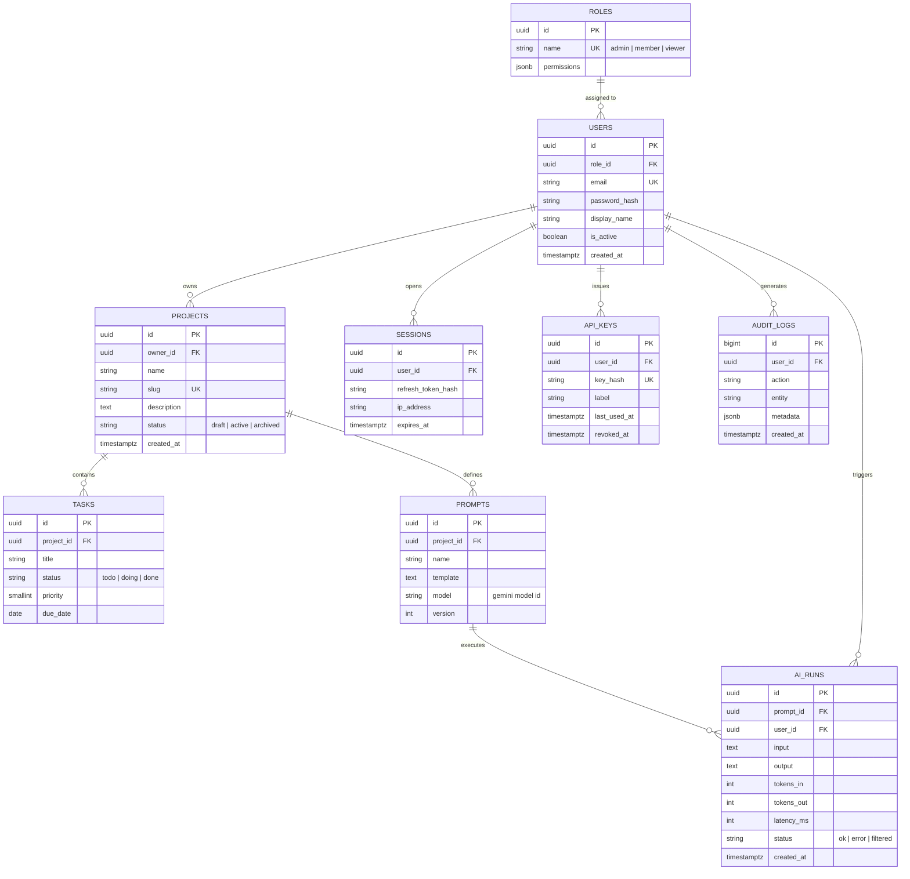
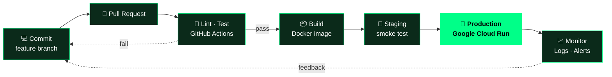

<!-- ═══════════════════════════════════════════════════════════════
     SAMUEL INDRA BASTIAN: GitHub Profile README
     Ganti semua GITHUB_USERNAME dengan username GitHub kamu
═══════════════════════════════════════════════════════════════ -->

<div align="center">


<a href="https://samuelindrabastian.my.id">
  
</a>

<br/>

<a href="https://samuelindrabastian.my.id"></a>
<a href="mailto:mesakzitumpul@gmail.com"></a>
<br/>


<br/><br/>


</div>


## 🖥️ `~/whoami`

```bash
samuel@archdev:~$ whoami
Samuel Indra Bastian · Software Engineer · Indonesia 🇮🇩

samuel@archdev:~$ cat philosophy.txt
Clean code. Scalable systems. Elegant, user-centric experiences.

samuel@archdev:~$ cat now.json
{
  "focus"    : "Dynamic web apps + AI-powered features",
  "learning" : ["Google Cloud Platform", "Firebase", "DevOps", "Full-stack architecture"],
  "stack"    : ["Laravel", "TypeScript", "React", "Node.js"],
  "ask_me"   : ["Laravel", "TypeScript", "React", "API Design", "Cloud Computing"],
  "contact"  : "mesakzitumpul@gmail.com"
}

samuel@archdev:~$ _
```


## 🌐 Language / Bahasa

<details open>
<summary><b>🇬🇧 English</b> (click to collapse)</summary>
<br/>

I'm a **Software Engineer** from Indonesia who designs and builds robust web applications, explores practical AI solutions, and turns complex ideas into elegant, user-centric digital products.

My approach: **think in systems, write clean code, and stay at the forefront of modern web technology.**

| | |
|:--|:--|
| 🔭 **Current focus** | Building dynamic web applications and integrating AI features |
| ☁️ **Google Developer journey** | GCP services, Firebase architecture, Gemini API |
| 🌱 **Improving** | Full-stack architecture, DevOps, cloud systems |
| 💬 **Ask me about** | Laravel · TypeScript · React · API Design · Cloud |
| 🌍 **Website** | [samuelindrabastian.my.id](https://samuelindrabastian.my.id) |
| ✉️ **Email** | [mesakzitumpul@gmail.com](mailto:mesakzitumpul@gmail.com) |

</details>

<details>
<summary><b>🇮🇩 Bahasa Indonesia</b> (klik untuk membuka)</summary>
<br/>

Saya **Software Engineer** asal Indonesia yang merancang dan membangun aplikasi web yang andal, mengeksplorasi solusi AI yang praktis, dan mengubah ide kompleks menjadi produk digital yang elegan dan berorientasi pada pengguna.

Pendekatan saya: **berpikir dalam sistem, menulis kode bersih, dan selalu mengikuti teknologi web terkini.**

| | |
|:--|:--|
| 🔭 **Fokus saat ini** | Membangun aplikasi web dinamis dan mengintegrasikan fitur AI |
| ☁️ **Perjalanan Google Developer** | Layanan GCP, arsitektur Firebase, Gemini API |
| 🌱 **Sedang ditingkatkan** | Arsitektur full-stack, DevOps, sistem cloud |
| 💬 **Tanya saya tentang** | Laravel · TypeScript · React · API Design · Cloud |
| 🌍 **Website** | [samuelindrabastian.my.id](https://samuelindrabastian.my.id) |
| ✉️ **Email** | [mesakzitumpul@gmail.com](mailto:mesakzitumpul@gmail.com) |

</details>


## 🏗️ System Architecture

> Arsitektur referensi yang saya pakai untuk aplikasi web modern dengan fitur AI.




## 🔄 Request Flow: AI Feature

> Alur dari klik user sampai respons AI kembali ke layar.




## 🗄️ Database Design (ERD)

> Contoh skema relasional untuk platform multi-user dengan fitur AI: role-based access, project, task, riwayat AI run, dan audit log.



<details>
<summary><b>📜 Lihat contoh DDL PostgreSQL</b></summary>

```sql
CREATE TABLE ai_runs (
    id          UUID PRIMARY KEY DEFAULT gen_random_uuid(),
    prompt_id   UUID NOT NULL REFERENCES prompts(id) ON DELETE CASCADE,
    user_id     UUID NOT NULL REFERENCES users(id),
    input       TEXT NOT NULL,
    output      TEXT,
    tokens_in   INT  NOT NULL DEFAULT 0,
    tokens_out  INT  NOT NULL DEFAULT 0,
    latency_ms  INT,
    status      TEXT NOT NULL CHECK (status IN ('ok', 'error', 'filtered')),
    created_at  TIMESTAMPTZ NOT NULL DEFAULT now()
);

-- Index untuk query yang paling sering dipakai
CREATE INDEX idx_ai_runs_user_created ON ai_runs (user_id, created_at DESC);
CREATE INDEX idx_ai_runs_prompt       ON ai_runs (prompt_id);
```

</details>

**Prinsip desain database:** UUID untuk ID publik · foreign key + constraint di level database · soft-revoke untuk kredensial · index berdasarkan pola query nyata · `jsonb` hanya untuk data yang memang fleksibel.


## 🚀 CI/CD & Delivery Pipeline




## 🧠 Engineering Principles

<div align="center">

| 🧱 Structure | 🔐 Security | 📈 Scale | 🧪 Quality |
|:--|:--|:--|:--|
| Separation of concerns | Validate every input | Simple first, optimize with data | Readable, testable code |
| API-first contracts | Auth & least privilege | Cache & queue where it matters | Automated CI checks |
| Modular, replaceable parts | Secrets never in code | Stateless services | Code review habit |

</div>


## 🛠️ Tech Stack

<div align="center">


<br/><br/>


</div>

| Layer | Technologies |
|:--|:--|
| 🖥️ **Frontend** | HTML5 · CSS3 · JavaScript · TypeScript · React · Tailwind CSS |
| ⚙️ **Backend** | PHP · Laravel · Node.js · Express |
| 🗄️ **Database** | PostgreSQL · MongoDB |
| ☁️ **Cloud & AI** | Google Cloud Platform · Firebase · Gemini API |
| 🧰 **Tools** | Git · VS Code · Linux |


## 📊 GitHub Analytics

<div align="center">


<br/>


<br/>


<br/><br/>


</div>


## 🤝 Let's Build Something Together

<div align="center">

<a href="https://samuelindrabastian.my.id"></a>
<a href="mailto:mesakzitumpul@gmail.com"></a>
<a href="https://linkedin.com/in/samuelindrabastian"></a>
<a href="https://twitter.com/xynooswebdev"></a>
<a href="https://instagram.com/samuelindrabastian"></a>

<br/><br/>


</div>


