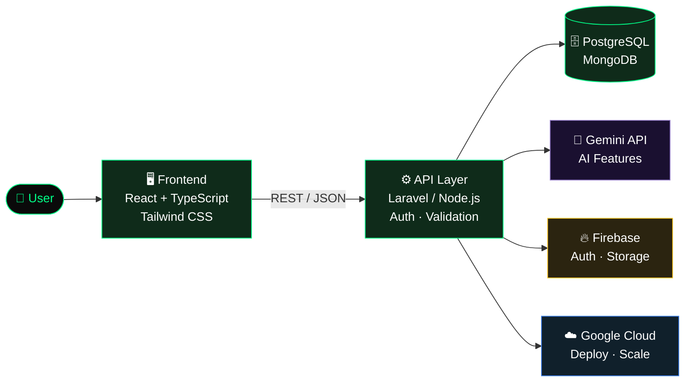

<!-- ═══════════════════════════ HEADER ═══════════════════════════ -->
<div align="center">
  

  <a href="https://github.com/samuelindrabastian">
    
  </a>

  <br/><br/>

  <a href="https://samuelindrabastian.me"></a>
  <a href="mailto:corndonate9@gmail.com"></a>
  
  
</div>

<br/>

<!-- ═══════════════════════════ TERMINAL CARD ═══════════════════════════ -->
```bash
samuel@dev:~$ whoami
> Samuel Indra Bastian: Software Engineer, Indonesia 🇮🇩

samuel@dev:~$ cat philosophy.txt
> Clean code. Scalable systems. Elegant, user-centric experiences.

samuel@dev:~$ cat now.json
{
  "focus"    : "Dynamic web apps + AI-powered features",
  "learning" : ["Google Cloud Platform", "Firebase", "DevOps", "Full-stack architecture"],
  "stack"    : ["Laravel", "TypeScript", "React", "Node.js"],
  "ask_me"   : ["Laravel", "TypeScript", "React", "API Design", "Cloud"]
}
```

---

## 🌐 Language / Bahasa

<details open>
<summary><b>🇬🇧 English</b></summary>
<br/>

I'm a **Software Engineer** from Indonesia who designs and builds robust web applications, explores practical AI solutions, and turns complex ideas into elegant, user-centric digital products.

My approach is simple: **think in systems, write clean code, and stay current with modern web technology.**

| | |
|---|---|
| 🔭 **Current focus** | Building dynamic web applications and integrating AI features |
| ☁️ **Google Developer journey** | Learning GCP services, Firebase architecture, and the Gemini API |
| 🌱 **Improving** | Full-stack architecture, DevOps, and cloud systems |
| 💬 **Ask me about** | Laravel · TypeScript · React · API Design · Cloud Computing |
| ✉️ **Reach me** | [corndonate9@gmail.com](mailto:corndonate9@gmail.com) |

</details>

<details>
<summary><b>🇮🇩 Bahasa Indonesia</b></summary>
<br/>

Saya **Software Engineer** asal Indonesia yang merancang dan membangun aplikasi web yang andal, mengeksplorasi solusi AI yang praktis, dan mengubah ide kompleks menjadi produk digital yang elegan dan berorientasi pada pengguna.

Pendekatan saya sederhana: **berpikir dalam sistem, menulis kode bersih, dan selalu mengikuti teknologi web terkini.**

| | |
|---|---|
| 🔭 **Fokus saat ini** | Membangun aplikasi web dinamis dan mengintegrasikan fitur AI |
| ☁️ **Perjalanan Google Developer** | Mempelajari GCP, arsitektur Firebase, dan Gemini API |
| 🌱 **Sedang ditingkatkan** | Arsitektur full-stack, DevOps, dan sistem cloud |
| 💬 **Tanya saya tentang** | Laravel · TypeScript · React · API Design · Cloud Computing |
| ✉️ **Hubungi saya** | [corndonate9@gmail.com](mailto:corndonate9@gmail.com) |

</details>

---

## 🏗️ How I Architect

Pola arsitektur yang biasa saya pakai untuk aplikasi web dengan fitur AI:



**Prinsip engineering:**

- 🧱 **Separation of concerns**: UI, business logic, dan data dipisahkan dengan jelas
- 📐 **API-first design**: kontrak API dirancang sebelum implementasi
- 🔐 **Secure by default**: validasi input, auth, dan secret management sejak awal
- 📈 **Scale when needed**: sederhana dulu, optimasi berdasarkan data, bukan asumsi
- 🧪 **Maintainable code**: mudah dibaca, mudah diuji, mudah diteruskan orang lain

---

## 🛠️ Tech Stack

<div align="center">

### 🖥️ Frontend


### ⚙️ Backend


### ☁️ Cloud & AI


### 🗄️ Database & Tools


</div>

---

## 📊 GitHub Stats

> ⚠️ Ganti `GITHUB_USERNAME` di bawah dengan username GitHub kamu.

<div align="center">
  
  
  <br/>
  
</div>

<div align="center">
  
</div>

---

## 🤝 Let's Connect

<div align="center">
  <a href="https://samuelindrabastian.me"></a>
  <a href="https://linkedin.com/in/samuelindrabastian"></a>
  <a href="https://twitter.com/xynooswebdev"></a>
  <a href="https://instagram.com/samuelindrabastian"></a>
  <a href="mailto:corndonate9@gmail.com"></a>
</div>

<br/>

<div align="center">
  
  
  <br/><br/>
  <i>"Make it work, make it right, make it fast."</i> — Kent Beck
</div>


